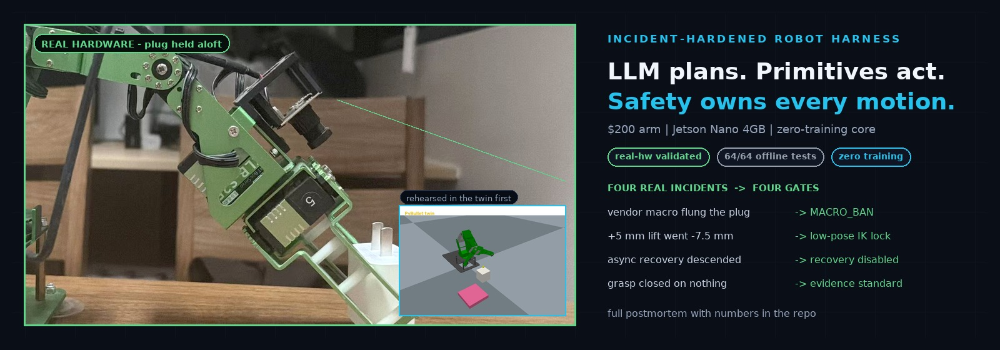
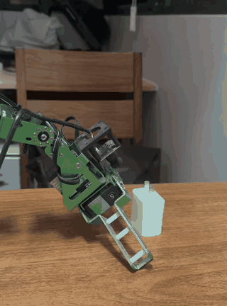
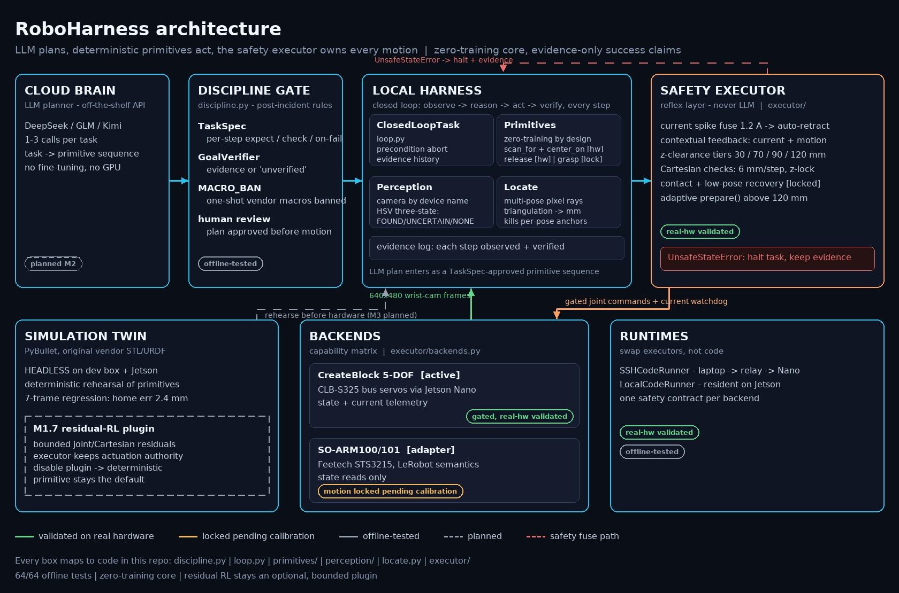
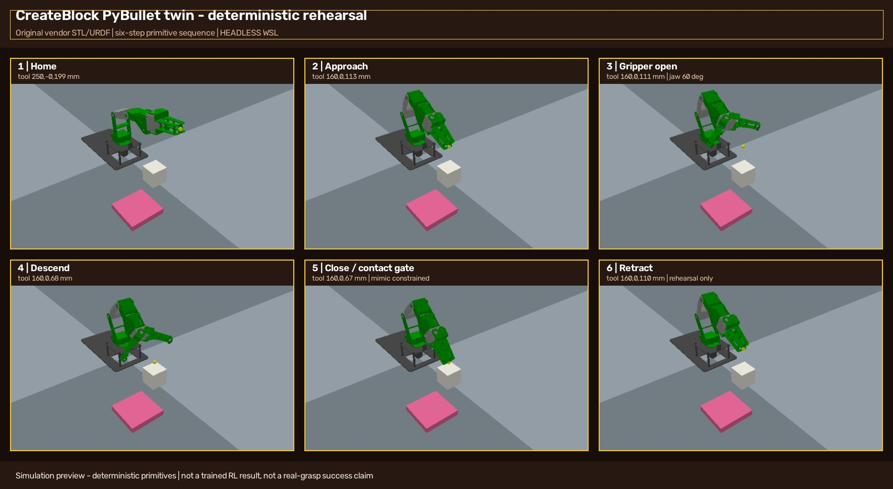
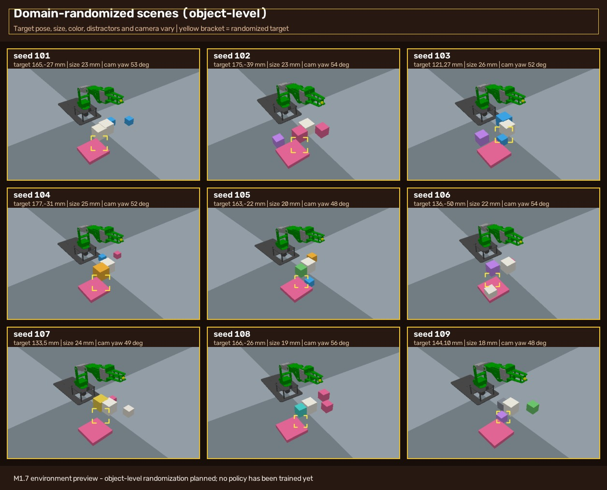

# RoboHarness

[](https://github.com/vicfei/RoboHarness/actions/workflows/ci.yml)

<p align="center">
  
</p>

<p align="center">
  
</p>

<p align="center"><sub>13 s, real hardware, third-person view: descend → close → hold.
The first fully-automatic closed-loop grasp (scan → center → grasp → verify), 2026-11-14.
Full-quality clip: <a href="docs/assets/hero/arm_hold.mp4">arm_hold.mp4</a></sub></p>

**An incident-hardened harness for $200-class 5-DOF bus-servo arms: LLM agents
plan, deterministic primitives act, a real-hardware safety layer owns every
motion. Zero training.**

Same bet as [RoboHarness (arXiv:2610.14018)](https://arxiv.org/abs/2610.14018) —
*a simple harness outperforms VLA and world action models* — but running on
hardware the benchmark projects don't touch: a **$200-class 5-DOF bus-servo arm +
a 4GB Jetson Nano**, controlled end-to-end in the real world. This repository is
independent of the official [BinceQu/RoboHarness](https://github.com/BinceQu/RoboHarness)
benchmark codebase.

> Status: **first fully-automatic closed-loop grasp completed on real hardware**
> (scan → center → grasp → verify, 2026-11-14). The 2026-11-15 rerun hardened
> free-space autonomy but exposed a missing jaw-contact model, so contact
> primitives are locked until that calibration lands. 64/64 offline tests pass.

## Why a harness (and not another VLA)

- **Zero training in the core path.** A cloud LLM (DeepSeek / GLM / Kimi — any
  of them) plans at 1–3 calls per task; deterministic code does 100% of the
  actuation. A bounded residual-RL skill is planned as an optional plugin, never
  as a bypass around the executor.
- **Cheap hardware, honest engineering.** ±5–10 mm servo repeatability and a
  640×480 wrist cam mean open-loop is unusable — everything here is
  vision-closed-loop by construction.
- **Safety from real incidents.** The safety layer encodes lessons from actual
  failures: servo stalls, driver brown-outs, gravity-collapsed storage poses,
  camera-index drift, detector false positives.

## The safety layer (built into the executor)

| Gate | Behavior |
|---|---|
| Contextual feedback | Angle/FK tracking plus live current telemetry everywhere; low-load current is accepted only with measured motion. No-motion/low-current and overcurrent still fuse. Grasp evidence combines grip angle, close-current peak, and jaw-region vision |
| Current spike fuse | Any loaded joint > 1.2 A → auto-retract two steps |
| Startup self-check | Tool height < 30 mm (collapsed pose) → refuse task (a vendor `home()` would press the arm harder into its jam) |
| Low-pose recovery lock | Tool height < 70 mm → refuse Cartesian IK; coordinated joint recovery is also disabled after asynchronous servo response caused a real descent. Power-cycle and manual safe posing are required |
| Adaptive free-space preparation | `prepare()` legalizes out-of-range joints automatically when the full FK path stays above 120 mm; observation-only transitions may use a 90 mm clearance. Servo-limit reads include a 0.03 rad deadband tolerance |
| Cartesian postconditions | In-motion current + FK watchdog, then direction/progress/6 mm/z-lock checks; small joint errors are not accepted as Cartesian success |
| Contact-approach lock | Contact Cartesian deltas and low joint-pose approaches are disabled by default after repeated empty closures and height undershoot. They remain offline-tested but require a calibrated jaw-contact model before real reuse |
| Three-state detection | FOUND / UNCERTAIN / **NONE** — weak candidates are never "best-effort" picked |
| Camera by device name | DirectShow indices drift across processes; device-name addressing is the only reliable path |

## Why this is not “another RoboHarness clone”

The adjacent projects are excellent at benchmarks, model serving, and
multi-embodiment breadth. This repo owns a different, underserved layer:

| Project | Public focus | This repo's difference |
|---|---|---|
| [BinceQu/RoboHarness](https://github.com/BinceQu/RoboHarness) | BEHAVIOR/RoboDojo agent control panel; R1 Pro / ARX X5 workspaces | Cheap real bus-servo executor with incident-derived safety gates |
| [showlab/Show-Harness](https://github.com/showlab/Show-Harness) | Semantic action units for VLMs across Franka/Piper/simulators | Deterministic primitive interpreter for hardware without depth or compliant control |
| [Open-RUA/uni-robot-agent](https://github.com/Open-RUA/uni-robot-agent) | Unified robot-use agent runtime and integrations | Tiny resident harness that fits a 4GB Jetson and refuses unsafe motion |
| [HexaFuture/HexaShell](https://github.com/HexaFuture/HexaShell) | 14 general tools + SAM 3 across four sim benchmarks | Honest single-arm bring-up and failure forensics, not leaderboard breadth |
| [huggingface/lerobot](https://github.com/huggingface/lerobot) | Low-cost-arm data, teleoperation, imitation/VLA learning | Zero-training execution and verification stack rather than policy training |

Full snapshot and interop path: [docs/landscape.md](docs/landscape.md).

## Ecosystem

An indie wave of robot-use harnesses is forming — different bodies, the same
bet that a thin execution layer beats end-to-end policies. These are
independent projects (not affiliated; listed for discovery). We link them so
visitors can compare approaches; several link back.

| Project | Angle | Complements this repo with |
|---|---|---|
| [showlab/Show-Harness](https://github.com/showlab/Show-Harness) | Semantic action units for VLMs | Franka/Piper/simulator breadth |
| [Open-RUA/uni-robot-agent](https://github.com/Open-RUA/uni-robot-agent) | Unified robot-use agent runtime | Open-weight VLM tool loop across environments |
| [HexaFuture/HexaShell](https://github.com/HexaFuture/HexaShell) | 14 general tools + SAM 3 | Four sim benchmarks, leaderboard scale |
| [robot-agent-exploration/RAX](https://github.com/robot-agent-exploration/rax) | Coding-agent task exploration + skill compilation | Franka FR3 / Rainbow real-robot branches |
| [xiao-yang25/robot-harness](https://github.com/xiao-yang25/robot-harness) | C++17 execution runtime, ROS 2 / Gazebo | Execution ownership & bounded recovery design |
| [tensortron/robot-use](https://github.com/tensortron/robot-use) | Coding agents on bimanual SO-101 | MuJoCo preview + skill promotion workflow |
| [stacx-lab/kinex](https://github.com/stacx-lab/kinex) | Coding agents → robots/simulators | Device/tool/skill layers on the Pi SDK |
| [YidaYang/embodify](https://github.com/YidaYang/embodify) | MCP server for robot skills | LIBERO/RoboDojo backends for any MCP host |

Hardware ecosystem: the SO-100/101 read-only adapter here speaks Feetech
STS3215 / [LeRobot](https://github.com/huggingface/lerobot) joint semantics —
built to give [SO-ARM100](https://github.com/TheRobotStudio/SO-ARM100) builders
a safety-hardened execution option once that backend earns real-hardware
evidence.

Building a robot-use harness? PRs to this table are welcome.

## Architecture



The pipeline in one line: **cloud LLM plans → discipline gate reviews → local
harness closed-loops → safety executor owns every motion → backends.**

| Layer | What lives there | Status |
|---|---|---|
| Cloud brain | DeepSeek / GLM / Kimi API, 1–3 calls per task, emits a primitive sequence | planned (M2) |
| Discipline gate | `TaskSpec` (per-step expect/check/on-fail), `GoalVerifier`, `MACRO_BAN`, human plan review | offline-tested |
| Local harness | `ClosedLoopTask` observe→reason→act→verify loop · deterministic primitives · three-state HSV perception · multi-pose ray triangulation · evidence log | real-hw validated (grasp locked) |
| Safety executor | Current spike fuse, contextual current+motion feedback, z-clearance tiers 30/70/90/120 mm, Cartesian postconditions, contact/low-pose locks, adaptive `prepare()` | real-hw validated |
| Backends | CreateBlock active behind task gates; SO-100/101 state-read adapter with motion locked | capability matrix |
| Sim twin + runtimes | PyBullet rehearsal (vendor STL/URDF), SSH/Local code runners; residual RL stays a bounded optional plugin | working / planned |

Four deterministic primitives anchor the loop:
`scan_for` (multi-stance sweep, hardware-proven) ·
`center_on` (sign-probe visual servoing, proven for observation alignment) ·
`grasp` (evidence-gated close, currently locked pending jaw-contact calibration) ·
`release`.

Diagram regenerable with `python scripts/generate_architecture_diagram.py`;
status colors are the honesty contract (green = real-hardware validated,
amber = locked, dashed = planned).

Swap executors, not code: `SSHCodeRunner` (laptop→arm link, validated) and
`LocalCodeRunner` (harness resident on the Jetson) behind one interface. SO-100/101
starts as a read-only LeRobot-bus adapter; its motion capability flag remains false
until that embodiment passes the same safety evidence used here for CreateBlock.

## Simulation twin

The arm ships with a vendor PyBullet twin (original STL/URDF), ported off the
Jetson Nano to the dev box for HEADLESS rehearsal and regression — the same
deterministic primitives run in sim before they touch hardware. Both renders
below are **environment previews: no policy has been trained on them**, and the
sequence is a primitive rehearsal, not a claimed grasp success.

| Deterministic rehearsal sequence (six primitives, HEADLESS WSL) | Domain-randomized scenes (M1.7 preview) |
|---|---|
|  |  |

The randomized grid sweeps target pose/size/color, distractors, and camera
viewpoint (yellow brackets mark the target) as the candidate environment for the
planned [bounded residual-RL pilot](docs/residual-rl-plan.md). Regenerate either
image with `python scripts/generate_sim_gallery.py` (requires the local sim twin
from `~/services/robotics/createblock-arm/sim`).

## Hardware support

| Arm | State read | Motion | Notes |
|---|---|---|---|
| CreateBlock 5-DOF (loborobot, CLB-S325 bus servos) | ✅ | ✅ with task gates | Active hardware backend; free-space autonomy validated, contact primitives locked pending jaw calibration |
| SO-ARM100/101 (Feetech STS3215 via LeRobot semantics) | ✅ adapter | 🔒 locked | Joint/gripper state mapping is offline-tested; motion stays disabled until current telemetry, FK clearance, and jaw-contact gates are calibrated |
| Mainstream arms (xArm / ARX / …) | — | — | Roadmap; bring your own executor behind the same safety contract |

## Quickstart (offline, no hardware needed)

```bash
pip install numpy opencv-python-headless
python -m unittest discover -s tests -v   # 64/64 offline tests
```

## Docs

- [POSTMORTEM.md](POSTMORTEM.md) — four real-robot incidents and the safety gates they shipped (the why behind this repo)
- [docs/harness-design.md](docs/harness-design.md) — design v1 (three-tier brain, primitives, failure modes, M1–M4)
- [docs/landscape.md](docs/landscape.md) — GitHub landscape snapshot, naming collision, and interop path
- [docs/residual-rl-plan.md](docs/residual-rl-plan.md) — planned M1.7 bounded residual-RL pilot; harness keeps actuation and verification authority
- [docs/createblock-integration-log-zh.md](docs/createblock-integration-log-zh.md) — raw Chinese working log: full bring-up, incidents, adaptive autonomy, and the jaw-contact gap

Supervisor/evidence pattern borrowed from the ORA line of work — credit where due.

## License

MIT
